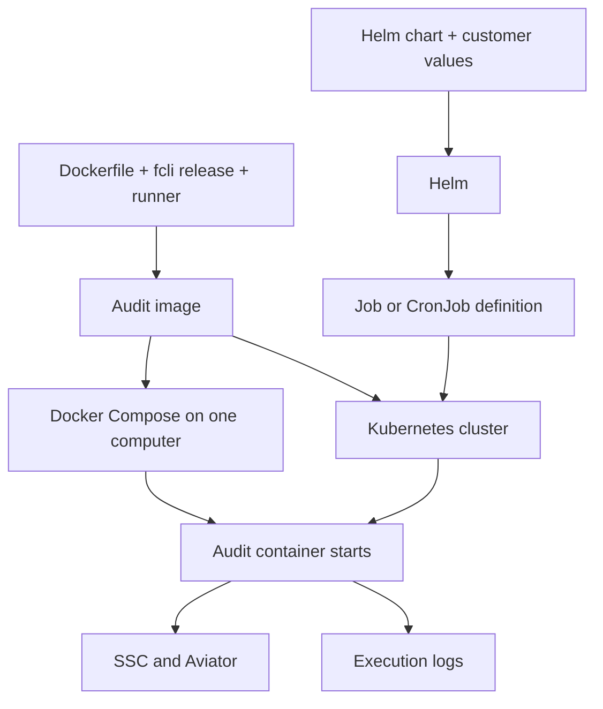
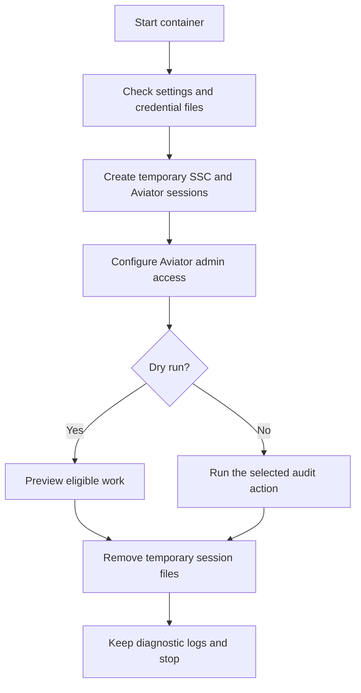
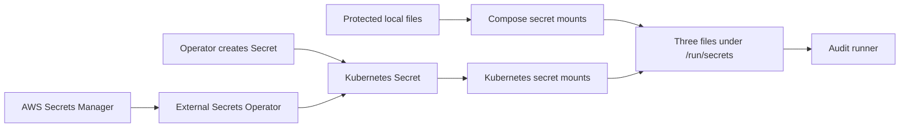
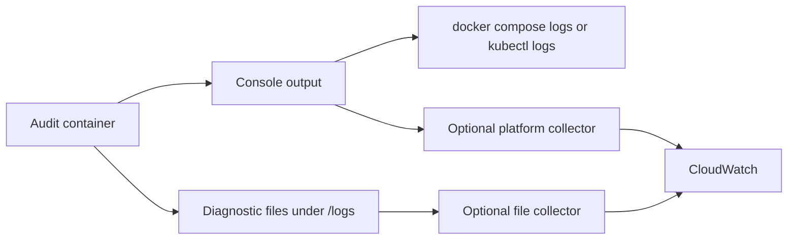

# Bulk Audit POC: Demo Guide

This project packages fcli so customers can run a Fortify bulk audit with consistent settings.
Use Docker Compose on one computer. Use the Helm chart on a Kubernetes cluster.
Both methods run the same audit image.

POC means proof of concept. This project demonstrates the design before production approval.
This guide describes the repository on 2026-11-01.

## 1. What problem does this project solve?

Without this project, an operator must install fcli, create sessions, run commands, and manage logs.
This project packages those steps into a container that runs once and stops.
The operator supplies connection settings and credentials before each execution.

The container does not need an existing fcli installation or login session on the computer.
The container still needs network access to SSC and Aviator.

| Term | Simple meaning |
| --- | --- |
| fcli | The Fortify command-line tool. It sends commands to Fortify services. |
| SSC | Software Security Center. It stores application versions and security results. |
| Aviator | The service used to audit eligible security results. |
| SAST | Static application security testing. Start the demo with existing SAST results. |
| DAST | Dynamic application security testing. This action needs suitable WebInspect results. |
| Bulk audit | An action that selects eligible application versions and audits their results. |
| Dry run | A preview that connects to the services without performing the audit. |
| Filter | A selection rule that limits which application versions the action considers. |

This POC audits existing results. The POC does not build application code or start a new security scan.

| Action | Purpose |
| --- | --- |
| `audit-sast` | Audit SAST results. This is the default action. |
| `audit-dast` | Audit DAST results. |
| `sast-dast-correction` | Correlate existing SAST and DAST results using `bulkcorrelate`. |

Only these three runner action names are accepted. `audit-sast` maps to fcli `bulkaudit-sast`; `audit-dast` maps to `bulkaudit-dast`. The requested name `sast-dast-correction` maps to fcli SAST?DAST **correlation**, not remediation. `BULK_AUDIT_MAX_AUDITS` (Helm: `audit.maxAudits`) limits application versions for all three actions: it becomes `--max-correlations` for correlation and `--max-audits` for audits. Existing deployments must replace old `bulkaudit*` configuration values with the new runner names.

## 2. What do Docker, Compose, Kubernetes, and Helm do?

| Component | Role in this project | Why we need this component |
| --- | --- | --- |
| Dockerfile | Instructions for building an image. | Defines the fcli version, supporting software, user, and startup command. |
| Image | A package containing fcli and the audit runner. | Gives each execution the same software. |
| Container | A running instance of the image. | Executes the audit with supplied settings and credentials. |
| Docker Engine | Builds images and runs containers. | Runs the local Compose deployment. |
| Docker Compose | Reads `compose.yaml` and starts the container. | Applies credentials, settings, storage, and limits together. |
| Kubernetes | Manages containers on a cluster. A cluster contains one or more computers called nodes. | Runs Jobs and schedules work. |
| Pod | The Kubernetes unit that holds our audit container. | Gives the container its settings, storage, and network access. |
| Job | Kubernetes work that runs to completion. | Runs one manual audit execution. |
| CronJob | A Kubernetes schedule that creates Jobs. | Starts audits at configured times. |
| Helm | A tool that installs Kubernetes resources from a chart. | Applies customer settings without editing every Kubernetes template. |
| Helm chart | The templates and default settings under `charts/fcli-bulk-audit/`. | Defines the Job or CronJob and its container configuration. |
| Helm release | A named installation of the chart, such as `poc`. | Identifies an installation for inspection and removal. |

Helm does not build the image or create the cluster.
Kubernetes can run the image without a Docker Engine on each node.
Docker Compose does not provide a scheduler.
You do not need Compose and Helm together for each audit.



The Dockerfile downloads a released fcli binary and verifies its publisher signature.
The Compose build also supplies an archive checksum to verify the expected download.
The build does not compile the sibling fcli repository in the parent directory.

The current POC settings select:

- fcli release: `v3.29.0`.
- Image: `fcli-bulk-audit:3.29.0-poc.2`.
- Helm chart: `0.2.3`.
- Platform: Linux on Intel or AMD 64-bit processors.

These settings select fixed versions. The build does not automatically select the newest fcli release.

## 3. What happens when the container starts?

The startup command runs `linux/bulk-audit.sh`.
This script coordinates fcli commands and manages temporary files.



1. The runner checks settings, file access, and required values.
2. The runner creates private temporary directories for its sessions and working files.
3. The runner logs into SSC with the SSC token.
4. The runner logs into Aviator with the Aviator user token.
5. The runner configures Aviator admin access with the tenant and private key.
6. The runner executes the selected action with the filter, preview setting, and audit limit.
7. The runner writes progress and status output while fcli runs.
8. The runner removes temporary session files when the process exits normally or handles a stop signal.

Only `audit-sast` receives `--add-aviator-tags` so fcli can prepare the required Aviator tag.
A live audit can change SSC results, create Aviator applications, and consume quota.

The default configuration previews work and limits execution to one application-version audit.
One application version can contain many issues. The limit does not mean one issue.
An empty filter can consider all eligible versions. Set the filter before the demo.

The runner stops if a login command fails.
The runner applies a timeout and does not retry audits automatically.

**A successful process exit does not prove that every audit operation succeeded.**
fcli can report a successful exit after individual audit failures.
Check the action output and SSC results before reporting success.

## 4. Where do credentials and logs go?

### Credentials

An image contains software. Credentials arrive separately when the container starts.
The runner expects these three files:

| Container path | Purpose |
| --- | --- |
| `/run/secrets/ssc-token` | Authenticate to SSC. |
| `/run/secrets/aviator-token` | Authenticate the Aviator user. |
| `/run/secrets/aviator-private-key` | Configure Aviator admin access. |

Compose mounts protected files from the computer.
Helm references an existing Kubernetes Secret, which stores credential values inside the cluster.
Kubernetes mounts the Secret entries as read-only files.
The Helm chart does not create the credential Secret.



External Secrets Operator is an optional service that copies external credentials into Kubernetes Secrets.
Our AWS example refreshes the Kubernetes Secret every hour.
The customer installs the operator and grants access to the selected AWS secret.
Use either manual management or the operator for the same Secret.

The audit container does not need AWS credentials for this integration.
Each new audit execution reads the supplied credential files again.
The credential owner must replace expired SSC and Aviator credentials.

Do not put tokens into `.env`, Helm values, commands, or the image.
The runner passes the SSC token through the login process environment because this fcli interface requires that method.
File injection reduces exposure but does not remove the need for host and cluster access controls.
Kubernetes Secret storage also needs access controls and encryption configured by the cluster owner.

### Logs

| Output | Contents | How to read the output |
| --- | --- | --- |
| Console output | fcli output and structured execution events. | `docker compose logs` or `kubectl logs`. |
| Diagnostic files | Separate files for SSC login, Aviator login, admin configuration, and the audit. | Read or export `/logs/<run-directory>/`. |

A run identifier connects execution events with their diagnostic directory.
The runner requests fcli's `high` masking setting. Review logs before sharing application data.



A platform collector is a separate program that forwards logs, such as Fluent Bit.
The customer operations team installs the collector and manages access, delivery, and retention.
Retention means how long the service keeps logs.
You manage these responsibilities during a local POC.

Our Helm chart does not install a collector.
The Compose CloudWatch override sends console output through Docker's AWS logging driver.
The Fluent Bit example handles diagnostic files when an operator configures and runs that collector.

Compose keeps diagnostic files in a Docker volume, which is storage outside the container.
Helm uses temporary Pod storage by default. Deleting the Pod removes those diagnostic files.
An existing persistent volume claim can retain Helm diagnostic files outside the Pod.
A persistent volume claim requests storage from Kubernetes.

## 5. Folder structure and file reference

Start with `linux/bulk-audit.sh`, `deploy/compose/`, and `charts/fcli-bulk-audit/`.
The repository also contains general fcli image files that predate this POC.

```text
fcli-docker/
|-- linux/                       Linux image and audit runner
|-- windows/                     General Windows image
|-- deploy/
|   |-- compose/                 Local execution settings
|   |-- kubernetes/              AWS secret integration example
|   `-- logging/                 Diagnostic collector example
|-- charts/
|   `-- fcli-bulk-audit/          Helm chart
|       `-- templates/           Kubernetes resource templates
|-- tests/                       Runner and deployment checks
|-- .github/
|   `-- workflows/               Automated repository workflows
|-- docs/                        POC instructions
|-- README.md                    Repository entry point
|-- FCLI_REPO_CHANGES.md          Earlier repository migration notes
`-- IMPLEMENTATION_SUMMARY.md     Earlier repository setup notes
```

Paths below are relative to the repository root.

### Linux image files

| File | What the file does and why |
| --- | --- |
| `linux/Dockerfile` | Downloads fcli and builds several image variants. The `fcli-bulk-audit` target packages our runner. |
| `linux/bulk-audit.sh` | Validates inputs, logs in, runs the action, writes events, and removes temporary sessions. |
| `linux/docker-entrypoint.sh` | Starts commands in general shell images. Displays a welcome message for interactive use. |
| `linux/welcome.txt` | Supplies help text for general interactive Linux images. |
| `linux/welcome-sc-note.txt` | Adds a welcome note when the image includes ScanCentral Client. |
| `linux/minimal-passwd` | Defines the regular fcli user in the minimal `fcli-scratch` image. |
| `linux/data.tgz` | Supplies the initial `/data` directory for general images. This is not customer audit data. |
| `linux/tmp.tgz` | Supplies the initial `/tmp` directory for the `fcli-scratch` image. |
| `linux/.dockerignore` | Limits which local files Docker receives during the build. |
| `linux/.gitignore` | Excludes a local fcli executable from Git. |

The audit image starts `bulk-audit.sh` directly. The audit image does not use the interactive welcome script.
The general image variants serve other fcli use cases.

### Deployment files

| File | What the file does and why |
| --- | --- |
| `deploy/compose/compose.yaml` | Defines the local container, image build, file mounts, logs, and resource limits. |
| `deploy/compose/.env.example` | Supplies non-secret settings to copy into a local `.env` file. |
| `deploy/compose/compose.cloudwatch.yaml` | Replaces local console logging with the Docker CloudWatch driver. Requires separate AWS setup. |
| `deploy/compose/compose.truststore.yaml` | Mounts trusted certificates and their password file for private certificate authorities. |
| `deploy/kubernetes/external-secrets-aws.yaml` | Connects AWS Secrets Manager to the required Kubernetes Secret through External Secrets Operator. |
| `deploy/logging/fluent-bit-cloudwatch.conf` | Configures a separate Fluent Bit collector to send diagnostic files to CloudWatch. |

A truststore is a file containing certificates that the client trusts.
The optional truststore avoids disabling certificate verification for private service certificates.

### Helm chart files

| File | What the file does and why |
| --- | --- |
| `charts/fcli-bulk-audit/Chart.yaml` | Defines the chart name, version, fcli version, and Kubernetes version requirement. |
| `charts/fcli-bulk-audit/values.yaml` | Supplies default connection settings, action settings, image settings, limits, and scheduling settings. |
| `charts/fcli-bulk-audit/values.schema.json` | Checks supplied values for supported types and constraints before deployment. |
| `charts/fcli-bulk-audit/templates/workload.yaml` | Selects a Job or CronJob from `schedule.enabled`. |
| `charts/fcli-bulk-audit/templates/_helpers.tpl` | Defines names, labels, image references, and the shared Pod configuration. Mounts credentials and applies security settings. |
| `charts/fcli-bulk-audit/templates/NOTES.txt` | Prints deployment details, log commands, and the result-status limitation after installation. |
| `charts/fcli-bulk-audit/.helmignore` | Excludes local values and packaged archives from the chart package. |

The customer changes a local values file. Helm combines those values with the templates.
The default chart creates a Job. Scheduling starts disabled.
When enabled, the CronJob starts suspended until an operator allows execution.
The overlap rule applies within that CronJob. Separate installations do not coordinate their audits.

### Tests and automated workflows

CI means continuous integration. CI runs automated checks when repository changes trigger a workflow.

| File | What the file does and why |
| --- | --- |
| `tests/test_bulk_audit.py` | Uses a simulated fcli command to check runner behavior, credential handling, failures, cleanup, and timeouts. |
| `tests/test_deployments.py` | Checks generated Helm and Compose settings, security controls, and credential mappings. |
| `tests/smoke-images.sh` | Builds images and checks basic startup. Also checks simulated Windows checkout formatting. |
| `tests/requirements.txt` | Selects the PyYAML version used to read deployment settings during tests. |
| `.github/workflows/bulk-audit.yml` | Runs POC checks and security scans. Fails for critical image findings and fixable high image findings. |
| `.github/workflows/docker.yml` | Builds and optionally publishes general fcli image variants. Does not publish the audit target in its current matrix. |
| `.github/workflows/fortify-analysis.yml` | Calls the shared Fortify on Demand analysis workflow. Requires the repository's analysis configuration. |
| `.github/workflows/bump-shared-github.yml` | Calls a shared workflow that maintains references to shared GitHub automation. |
| `.github/copilot-instructions.md` | Provides repository guidance for a coding assistant. Has no role during an audit execution. |

Local automated tests do not prove that customer credentials, service connections, or AWS permissions work.

### Windows, documentation, and repository files

| File | What the file does and why |
| --- | --- |
| `windows/Dockerfile` | Builds general Windows fcli images. The bulk-audit POC uses the Linux image. |
| `windows/docker-entrypoint.cmd` | Starts commands in the Windows image and displays interactive help. |
| `windows/welcome.txt` | Supplies the Windows welcome text. |
| `windows/data.tgz` | Supplies the initial data directory for the Windows image. |
| `windows/.gitignore` | Excludes a local `fcli.exe` from Git. |
| `README.md` | Introduces the repository and links to POC instructions. |
| `docs/bulk-audit-demo-guide.md` | This explanation for preparing and presenting the demo. |
| `docs/bulk-audit-poc-runbook.md` | Short PowerShell procedures for Compose and Helm execution. |
| `docs/bulk-audit-poc-guide.md` | Detailed setup, integrations, troubleshooting, security audit, and remaining work. |
| `FCLI_REPO_CHANGES.md` | Historical instructions for moving Docker work out of the main fcli repository. |
| `IMPLEMENTATION_SUMMARY.md` | Historical notes about creating this separate repository. |
| `.gitignore` | Excludes local credentials, logs, settings, and generated files from Git. |
| `.gitattributes` | Sets Linux line endings for shell scripts, Dockerfiles, and YAML files. |

The historical documents are not the current bulk-audit runbook.

These local files appear during setup and remain outside Git:

| Local path | Purpose |
| --- | --- |
| `deploy/compose/.env` | Your non-secret service addresses and audit settings. |
| `deploy/compose/secrets/` | Your credential files. |
| `deploy/compose/certs/` | Your optional truststore. |
| `deploy/compose/logs/` | Exported execution logs. |
| `charts/fcli-bulk-audit/values.local.yaml` | Your Helm settings. |
| `.cache/` | Generated build, test, and audit artifacts. |

Git ignore rules do not protect file permissions. The computer owner must restrict credential access.

## 6. How to present the demo

### Prepare before the meeting

1. Choose Compose or Helm for the live execution.
2. Build the image before the meeting to avoid download delays.
3. Confirm network access to SSC and Aviator from the container environment.
4. Prepare the three credentials without displaying their contents.
5. Select one small test application through the filter.
6. Keep the dry-run setting enabled and the audit limit at `1`.
7. Follow the [temporary runbook](bulk-audit-poc-runbook.md) for the setup commands.

For Helm, use your existing Rancher Desktop Kubernetes cluster or another prepared test cluster.
The cluster must have access to the audit image.
The Helm chart works independently of the local cluster tool you select.

### A simple presentation order

| Order | Show | Say |
| --- | --- | --- |
| 1 | The diagram in section 2. | "We package fcli once and run the same image locally or in Kubernetes." |
| 2 | `.env.example` or `values.yaml`. | "Customers set service addresses, the selected action, and the application filter." |
| 3 | The credential diagram. | "Credentials arrive as files when the container starts. Credentials are not stored in the image." |
| 4 | A dry run and its logs. | "The runner logs in and previews the selected work before a live audit." |
| 5 | The selected application in SSC. | "We check the application and action output before allowing a live audit." |
| 6 | `schedule` settings in `values.yaml`. | "Kubernetes can schedule the same execution after manual testing passes." |
| 7 | The log diagram. | "The customer can send console logs and diagnostic files to their logging service." |

Show example settings instead of credential files.
Review saved output before screen sharing because logs can contain customer application details.

### Docker Compose demonstration

Run these commands in PowerShell from `deploy/compose` after completing the runbook setup.
Keep `BULK_AUDIT_DRY_RUN=true` for this demonstration.
Run each command separately. Stop if the image check fails.

```powershell
docker compose run --rm bulk-audit --check-image
docker compose up --abort-on-container-exit --exit-code-from bulk-audit --force-recreate bulk-audit
$auditExitCode = $LASTEXITCODE
Write-Output "Container exit code: $auditExitCode"
docker compose logs --no-color bulk-audit
```

The image check confirms expected fcli options. The image check does not test credentials or service access.

### Helm demonstration

Run these commands in PowerShell from the repository root after completing the runbook setup.
Keep `audit.dryRun: true` and `schedule.enabled: false` in the local values.
Use the release name `poc` only if that release does not already exist.
The install command below forces a manual dry run with an audit limit of `1`.

```powershell
kubectl config current-context
helm install poc charts/fcli-bulk-audit --namespace fcli-audit --values charts/fcli-bulk-audit/values.local.yaml --set audit.dryRun=true --set audit.maxAudits=1 --set schedule.enabled=false
kubectl -n fcli-audit get jobs,pods
kubectl -n fcli-audit logs -f job/poc-bulk-audit
```

Check the cluster context before installing. Repeat the logs command if the Pod is still starting.
Helm installation success only confirms that Kubernetes accepted the installation.
Read the action output to check the audit result.

### Repeat the Helm demo

1. Check that the previous Job has finished. Look for a `Complete` or `Failed` condition:

   ```powershell
   kubectl -n fcli-audit get job poc-bulk-audit -o 'jsonpath={.status.conditions[*].type}'
   ```

   Wait if neither condition appears.

2. Save the console output before uninstalling. Each filename includes the current time:

   ```powershell
   New-Item -ItemType Directory -Force deploy/compose/logs
   $demoLog = 'deploy/compose/logs/helm-demo-' + (Get-Date -Format 'yyyyMMdd-HHmmss-fff') + '.log'
   kubectl -n fcli-audit logs job/poc-bulk-audit | Out-File -Encoding utf8 -ErrorAction Stop $demoLog
   if ($LASTEXITCODE -ne 0) { throw 'Could not save Job logs. Keep the release and inspect the Pod.' }
   ```

3. Uninstall the release after saving the output:

   ```powershell
   helm uninstall poc --namespace fcli-audit --wait
   ```

   Uninstalling removes the Job and its Pods. Default diagnostic storage disappears with the Pod.
   The separately created credential Secret, namespace, image, and local values remain available.
   The saved console output does not include every diagnostic file.
   Export required diagnostic files before uninstalling, as described in the [POC guide](bulk-audit-poc-guide.md).

4. Repeat the Helm demonstration commands above to create a fresh dry-run Job.

Skip uninstalling before the first installation.
If the previous Job failed, inspect its output and correct the cause before repeating.
Kubernetes does not rerun a completed Job when you repeat `helm upgrade` with unchanged settings.
Use uninstall followed by install for this manual demo.

### What proves the demo worked?

- The image check reports `image_compatible`.
- SSC login, Aviator login, and Aviator admin configuration succeed.
- The output reports `dry_run=true`.
- The preview selects the intended application version without operation failures.
- Logs identify the execution and show its progress.

No eligible versions means the command found no suitable work. That result does not demonstrate an audit.
If you demonstrate a live audit, follow the runbook and keep the limit at `1`.
Confirm the expected result in SSC and restore the dry-run setting afterward.

## 7. What should you say about production readiness?

The POC supplies a working deployment design and security controls.
The audit container runs as a regular user with restricted permissions.
Compose and Helm apply a read-only root filesystem and writable locations for temporary files and logs.
The runner disables core dumps, limits execution time, and removes temporary session data.

The POC still has limits:

- fcli can return exit code `0` after individual audit failures.
- The recorded security audit found unresolved image vulnerabilities. Review the [detailed guide](bulk-audit-poc-guide.md) and a current image scan.
- The customer must verify credential renewal, network access, and log retention.
- AWS integration examples require testing in the customer's AWS environment.
- The customer must validate unattended scheduling before enabling production audits.

Use this closing statement:

> The POC runs the same audit image through Compose or Kubernetes.
> Credentials remain separate from the image, and each execution produces logs.
> Production use still needs service validation, security review, and operational ownership.
